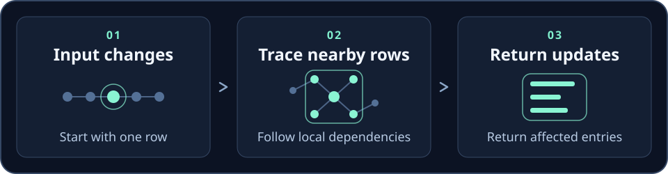
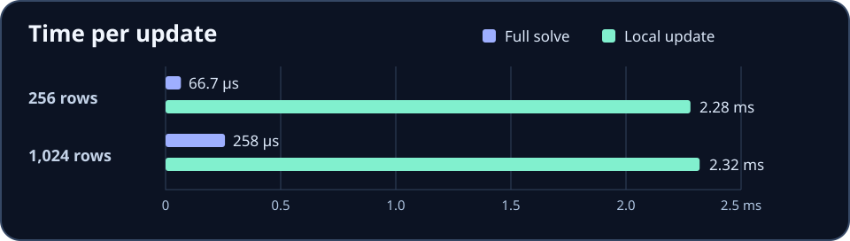

<a href="https://github.com/ruvnet/sublinear-time-solver"></a>

# Sublinear Time Solver: sparse linear solvers, PageRank and local push for JavaScript, MCP and Rust

[](https://www.npmjs.com/package/sublinear-time-solver)
[](https://www.npmjs.com/package/sublinear-time-solver)
[](https://crates.io/crates/sublinear)
[](https://www.npmjs.com/package/@ruvnet/sublinear-core)

Solve systems of equations, estimate individual values, and rank nodes in a graph. Use the command line, the JavaScript API, the Rust crate, or an MCP client.

The idea is simple. If a problem has many variables but each one depends on only a few others, the solver can sometimes answer a question by visiting a small neighborhood. Think of a sensor network where one reading changes and you want to check nearby readings first.

[Quick start](#quick-start) · [How it works](#how-it-works) · [MCP](#use-it-with-an-mcp-client) · [Library](#use-it-in-code) · [Benchmarks](#performance) · [Upgrading from 1.7](#upgrading-from-17)

| Package | Use it for | Runtime deps | Clean install |
| --- | --- | --- | --- |
| [`@ruvnet/sublinear-core`](packages/sublinear-core) | Embedding solvers and PageRank in a library or app | 0 | 1 package, 220 kB |
| [`sublinear-time-solver`](https://www.npmjs.com/package/sublinear-time-solver) | MCP server, CLI, and the 1.x `SublinearSolver` class | 4 | 99 packages, 31 MB (1.7.2: 220 packages, 123 MB) |
| [`sublinear`](https://crates.io/crates/sublinear) | Rust solvers with a complexity-typed API | — | `cargo add sublinear` |

## Quick start

With Node.js and npm, paste this into a terminal in a scratch directory. The matrix uses coordinate format (COO), which lists the value, row, and column of each nonzero entry.

```bash
cat > matrix.json <<'JSON'
{
  "rows": 2, "cols": 2, "format": "coo",
  "values": [4, -1, -1, 4],
  "rowIndices": [0, 0, 1, 1],
  "colIndices": [0, 1, 0, 1]
}
JSON
printf '%s\n' '[3,3]' > vector.json
npx -y sublinear-time-solver solve --matrix matrix.json --vector vector.json \
  --method forward-push --output solution.json
cat solution.json
```

The two values in `solution` should be close to `[1, 1]`, and `metadata.converged` should be `true`. Run `npx -y sublinear-time-solver --help` to see commands for inspecting matrices, generating test inputs, and running PageRank.

## How it works



A sparse matrix stores only the relationships that exist. A local solve starts with the row you care about, follows nearby dependencies, and returns a value or a small set of updates. The cost depends on how large that neighborhood gets and how much accuracy you need. A full solve returns every value, so its output grows with the size of the system.

| If you need | Start with |
| --- | --- |
| Every value in a system of equations | CLI or MCP `solve` |
| An estimate for one entry | MCP `estimateEntry` |
| A small set of updates after a local change | The [Rust event driven example](examples/event_driven_anomaly.rs) on the development branch |
| An importance score for each node in a graph | CLI `pagerank` or MCP `pageRank` |

The local path works best when rows have few neighbors, the diagonal terms dominate, and the change stays local. Inspect your matrix with `analyze` and check the residual when you need to know how closely a solution satisfies the equations.

## Use it with an MCP client

Add this to your client's MCP server configuration. It starts the server over standard input and output.

```json
{
  "mcpServers": {
    "sublinear-solver": {
      "command": "npx",
      "args": ["-y", "sublinear-time-solver", "serve"]
    }
  }
}
```

With Claude Code: `claude mcp add sublinear -- npx -y sublinear-time-solver serve`. With Codex, add `[mcp_servers.sublinear]` with `command = "npx"` and `args = ["-y", "sublinear-time-solver", "serve"]` to `~/.codex/config.toml`. All diagnostics go to stderr, so stdout carries only JSON-RPC.

Try asking your client to list the solver tools, then pass the COO matrix and vector from the quick start to `solve`. Clients can also inspect complexity metadata before choosing a tool. The [MCP server source](src/mcp/server.ts) has the tool schemas, and [ADR 001](docs/adr/ADR-001-complexity-as-architecture.md) explains the complexity budget.

## Use it in code

The zero-dependency core is the fastest way to embed the math:

```bash
npm install @ruvnet/sublinear-core
```

```js
import { solve, graphFromEdges, pageRank, personalizedPageRank, forwardPush, topK } from '@ruvnet/sublinear-core';

// A x = b. COO input; duplicate entries are summed. The residual is recomputed from x.
const { x, residual, converged } = solve(
  { rows: 2, cols: 2, rowIndices: [0, 0, 1, 1], colIndices: [0, 1, 0, 1], values: [4, -1, -1, 4] },
  [3, 3],
);

// PageRank and personalized PageRank on string ids
const g = graphFromEdges([['a', 'b'], ['b', 'c', 2], ['c', 'a'], ['a', 'c']]);
topK(pageRank(g).scores, 3, g);
personalizedPageRank(g, 'a', { damping: 0.85 });

// Local top-k: the work depends on epsilon, not on the graph size
topK(forwardPush(g, 'a', { epsilon: 1e-6 }).scores, 10, g);
```

- **`solve(A, b, { method })`** accepts COO, dense rows, or a `CsrMatrix` (`csrFromCoo`, `csrFromDense`).
  - The default `'auto'` uses conjugate gradient for symmetric matrices with a positive diagonal and Gauss-Seidel otherwise.
  - `'jacobi'` and `'neumann'` are also available. The two have identical iterates.
  - Jacobi, Neumann and Gauss-Seidel need diagonal dominance. Conjugate gradient needs a symmetric positive definite matrix.
- **`pageRank` / `personalizedPageRank`**: scores sum to 1. `damping` is the probability of following an edge, so a restart probability α means `damping = 1 − α`.
- **`forwardPush(g, seeds, { epsilon })` / `backwardPush(g, target)`**: local personalized PageRank. Forward push does at most 1/((1 − damping)·epsilon) pushes, whatever the graph size.
- **`estimateEntry(A, b, i, { walks })`**: estimates one entry of x by random walks and returns a standard error. After a one-time check per matrix, the cost does not depend on n.

The [core package README](packages/sublinear-core/README.md) has the full API. `sublinear-time-solver/core` exposes the same functions plus the 1.x `SublinearSolver` class, without loading the MCP server. For Rust, run `cargo add sublinear` and see the [crate documentation](https://docs.rs/sublinear/).

### Use it from agentdb, claude-flow or ruvector

Make `@ruvnet/sublinear-core` an optional dependency and keep your own fallback (`try { core = await import('@ruvnet/sublinear-core') } catch {}`).

- **claude-flow**: replace `simplePersonalizedPageRank` with `personalizedPageRank(graphFromEdges(edges), seed, { damping: 1 - restart })` and `topK(scores, k, graph)`. claude-flow's `damping` is the restart probability.
- **agentdb**: `SparsificationService` can use `personalizedPageRank(graphFromAdjacency(edges), source, { damping: 1 - alpha })`, or `forwardPush` for large graphs.
- **ruvector**: rank similarity or code graphs with `pageRank`, or smooth signals over them by solving `(I + L) x = y` with `solve`.

Runnable versions are in [`packages/sublinear-core/examples/`](packages/sublinear-core/examples).

## Performance

### Rust crate



On this benchmark, quadrupling the number of rows took the full solve from **66.7 µs to 258 µs** and the local update from **2.28 ms to 2.32 ms**. The full solve was faster at both sizes. The local update grew more slowly because the changed neighborhood stayed small. See the [benchmark setup and results](BENCHMARK.md).

### JavaScript core

**Setup.**
- **Harness:** [`packages/sublinear-core/bench/bench.mjs`](packages/sublinear-core/bench/bench.mjs). Reproduce with `npm run bench`. Add `LEGACY=<dir>` to time sublinear-time-solver 1.7.2, and `GRAPH_TRANSFORMER=<dir>` to time `@ruvector/graph-transformer`.
- **Inputs:** generated from fixed seeds. Linear systems are random sparse strictly diagonally dominant matrices with about 9 non-zeros per row.
- **Machine:** Node v22.23.2 on an AMD Ryzen 9 9950X, single-threaded. The machine was shared (load average about 30), so treat the numbers as indicative.
- **Timing:** best of 3 runs, except single runs at n = 1,000,000.

**Linear solves: accuracy against dense Gaussian elimination (n = 1,000, tolerance 1e-12).**

| Method | Time | Iterations | Relative residual | Max error vs dense |
| --- | ---: | ---: | ---: | ---: |
| Dense Gaussian elimination (reference) | 108.7 ms | — | — | — |
| core `gauss-seidel` | 0.95 ms | 13 | 7.0e-13 | 4.0e-13 |
| core `jacobi` | 2.04 ms | 20 | 2.5e-13 | 7.9e-14 |
| core `neumann` | 0.70 ms | 20 | 2.5e-13 | 7.9e-14 |
| 1.7.2 `SublinearSolver` neumann | 50.8 ms | 23 | **5.0e-1** | **1.3e-1** |

The 1.7.2 Neumann solver returned a wrong answer here because its series used the wrong sign. That is fixed in 1.8.0.

**Linear solves: scaling (tolerance 1e-10).**

| n | nnz | Build CSR | Gauss-Seidel | Jacobi | 1.7.2 Neumann |
| ---: | ---: | ---: | ---: | ---: | ---: |
| 10,000 | 90 k | 8.8 ms | 2.3 ms (11 iterations) | 1.5 ms (16 iterations) | 4,402 ms |
| 100,000 | 900 k | 70 ms | 32 ms | 43 ms | — |
| 1,000,000 | 9.0 M | 951 ms | 474 ms | 314 ms | — |

Full-vector solves cost time linear in nnz per iteration; they are not sublinear.

**Personalized PageRank head to head.**
- **Graphs:** unweighted, about 10 out-edges per node, no dangling nodes, so every implementation's conventions agree. Restart probability 0.15.
- **Error:** max absolute error against a power iteration run to 1e-14.
- **Timing:** core times exclude the one-time graph build. That build took 5.3 ms, 393 ms and 3.4 s at the three sizes. `pprScores` converts its adjacency-list input on every call, and that conversion is included in its time.

| n (edges) | core `personalizedPageRank` to 1e-9 | core, fixed 20 iterations | `@ruvector/graph-transformer` `pprScores` (native, 20 iterations) | core `forwardPush` eps 1e-4 | core `forwardPush` eps 1e-7 | 1.7.2 `computePageRank` |
| --- | --- | --- | --- | --- | --- | --- |
| 1 k (10 k) | 0.34 ms, err 4e-12 | 0.21 ms, err 2.4e-10 | 0.52 ms, err 2.4e-10 | 0.08 ms, err 8.8e-3 | 1.4 ms, err 1.0e-5 | 3,439 ms, err 0.82, scores sum to 0.54 |
| 100 k (1.0 M) | 46 ms, err 2e-13 | 33 ms, err 9.3e-11 | 85 ms, err 9.3e-11 | 0.20 ms, err 1.6e-3 | 187 ms, err 1.2e-4 | — |
| 1 M (10 M) | 1,502 ms, err 2e-13 | 783 ms, err 3.6e-10 | 1,506 ms, err 3.6e-10 | 0.16 ms, err 5.0e-4 | 331 ms, err 2.3e-4 | — |

**Where each tool fits.**
- **Many queries on one graph:** core power iteration reuses a prebuilt CSR graph. Here it matched `pprScores` exactly at equal iterations and was 1.9 to 2.6 times faster per query.
- **One query on a fresh graph:** `pprScores` is faster. It needs no separate build step, and the core's graph build costs about as much as 4 to 25 fixed-iteration queries.
- **Large graphs, top-k only:** `forwardPush` touches only the neighbourhood of the seed. It answered in under 0.4 ms at every size, with per-node error near `epsilon × degree`. The top-ranked nodes stay accurate; small scores do not.
- **Every score needed precisely:** run power iteration. A small `epsilon` makes push slower than power iteration.

**Global PageRank on skewed graphs with dangling nodes (tolerance 1e-9).**

| Graph | Build | `pageRank` | `personalizedPageRank` | Map-of-arrays PPR baseline (same iterations) | `forwardPush` top-10 overlap |
| --- | ---: | ---: | ---: | ---: | --- |
| n = 100 k, m = 1 M | 141 ms | 53 ms (18 iterations) | 35 ms (22 iterations) | 3,475 ms (same scores to 3e-18) | 8/10 at eps 1e-4 (0.27 ms), 9/10 at eps 1e-6 (10.6 ms) |
| n = 1 M, m = 10 M | 3.1 s | 562 ms (18 iterations) | 1.6 s (23 iterations) | — | 10/10 at eps 1e-4 (0.32 ms), 9/10 at eps 1e-6 (42 ms) |

**Single-entry estimates.** `estimateEntry` with 2,000 walks took 0.70 ms, 0.65 ms and 0.05 ms at n = 1 k, 100 k and 1 M. The walk-step count stayed at about 3,540 throughout. These times exclude the one-time O(nnz) validation of each matrix.

## What "sublinear" means here

The name refers to algorithms whose cost is bounded by the query, not by the problem size. That includes single-entry random-walk estimates, local forward and backward push, and the Rust crate's closure-restricted `solve_on_change_sublinear`. The benchmarks above show that property directly.

Computing the full solution vector, or full PageRank, is linear in nnz per iteration. No algorithm can produce all n entries in less than n time.

The `solveTrueSublinear` MCP tool, a Johnson-Lindenstrauss projection solver, returns an approximation. In a 100×100 diagonally dominant test its relative residual was about 6%. The tool now reports a `verified_relative_residual` with every answer. Use `solve` when you need an accurate vector.

## MCP tools

**Core:**
- `solve`: verified iterative solve
- `estimateEntry`
- `analyzeMatrix`
- `pageRank`
- `verifySparseSolution`
- `coherenceScore`
- `closureIndices`
- `solveOnChangeSublinear`
- `contrastiveSolveOnChangeSublinear`
- `estimateComplexityClass`
- `generateTestVector`
- `saveVectorToFile`: basename-only, confined to a state directory

**Approximate:**
- `solveTrueSublinear`
- `analyzeTrueSublinearMatrix`

**Experimental research tools:** temporal-lead calculators, psycho-symbolic reasoning, domain management, consciousness and emergence simulations, and the nanosecond scheduler. They ship for compatibility and exploration. Their outputs are simulations, not validated scientific measurements.

Every matrix argument is validated before a handler runs:
- indices must be in-range integers. This blocks property-key injection such as a `"__proto__"` index.
- values must be finite.
- dimension, non-zero and dense-allocation limits apply (`MATRIX_LIMITS`).

## Upgrading from 1.7

1.8.0 is a drop-in upgrade. The old exports and subpaths still work. The behaviour changes:

- **Neumann solves are now correct.** They return the solution of A x = b to the requested residual. 1.7.x could return vectors with large errors.
- **Non-convergence is reported, not thrown.** `SublinearSolver.solve` returns `converged: false` instead of throwing, and `residual` is always the true ‖A x − b‖₂ of the returned vector.
- **Push methods.** `forward-push`, `backward-push` and `bidirectional` use Gauss-Seidel for full linear solves, and the result's `method` field says so. Their 1.7.x implementations reported convergence at several percent error. For local PageRank push, use `forwardPush`/`backwardPush`.
- **`random-walk`** returns a Monte Carlo solution instead of throwing.
- **`computePageRank`** scores sum to 1: dangling-node mass is redistributed, and `personalized` vectors are normalized.
- **Output streams.** Nothing is written to stdout on import or during solves, and the MCP server routes all logs to stderr. Set `SUBLINEAR_DEBUG=1` for solver diagnostics on stderr.
- **MCP `solve`** always uses the verified solvers. The projection solver is still available as `solveTrueSublinear`.

## More resources

[Changelog and upgrade notes](CHANGELOG.md) · [Security policy](SECURITY.md) · [Issue tracker](https://github.com/ruvnet/sublinear-time-solver/issues) · [License](LICENSE)

The repository also includes [temporal lead solving](crates/temporal-lead-solver/), a [nanosecond scheduler](https://crates.io/crates/nanosecond-scheduler), and experimental [reasoning](crates/psycho-symbolic-reasoner/) and [consciousness exploration](src/consciousness-explorer/) modules.
