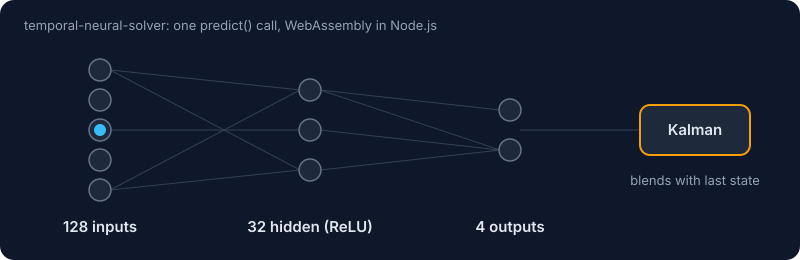

<a href="https://github.com/ruvnet/sublinear-time-solver/tree/main/crates/temporal-neural-solver-wasm"></a>

# temporal-neural-solver

[](https://www.npmjs.com/package/temporal-neural-solver)
[](https://github.com/ruvnet/sublinear-time-solver/blob/main/LICENSE)

A small neural network compiled to WebAssembly for Node.js, with a CLI.
Each `predict()` call runs a fixed 128 → 32 → 4 MLP (ReLU hidden layer) and then
smooths the 4 outputs with a per-output Kalman filter, so consecutive calls are
temporally coherent. The weights are deterministic (no training API); the package
is a fast, dependency-free inference kernel and a benchmark harness.

## Quick start

```bash
npx temporal-neural-solver demo          # single, batch and benchmark demo
npx temporal-neural-solver benchmark 10000
npx temporal-neural-solver info
```

```bash
npm install temporal-neural-solver
```

```javascript
const { TemporalNeuralSolver, benchmark, version } = require('temporal-neural-solver');

const solver = new TemporalNeuralSolver();

// One prediction: exactly 128 inputs -> 4 outputs
const result = solver.predict(new Float32Array(128).fill(0.5));
console.log(result.output);      // [0.237..., -0.363..., 0.336..., -0.107...]
console.log(result.latency_ns);  // time spent inside WebAssembly

// Batch: any multiple of 128 values
const batch = solver.predict_batch(new Float32Array(128 * 100));
console.log(batch.predictions.length, batch.throughput_ops_sec);

// Built-in benchmark and metadata
console.log(benchmark(1000).avg_latency_us);
console.log(solver.info().name, version());

solver.reset_state();            // clear the Kalman state
```

Wrong input sizes throw an `Error` (`"Input must be exactly 128 elements"`).

## API

| Call | Returns |
|---|---|
| `new TemporalNeuralSolver()` | a solver with its own Kalman state |
| `solver.predict(Float32Array(128))` | `{ output: number[4], latency_ns }` |
| `solver.predict_batch(Float32Array(128 * n))` | `{ predictions, total_latency_ms, avg_latency_us, throughput_ops_sec }` (no Kalman smoothing) |
| `solver.reset_state()` | resets the filter state |
| `solver.info()` | plain object: name, version, dimensions, features |
| `benchmark(iterations)` | `{ iterations, total_time_ms, avg_latency_us, throughput_ops_sec }` |
| `version()` | package version string |

## Performance

Measured with `npx temporal-neural-solver benchmark 10000` on Node.js 22, x86-64
Linux (AMD desktop): about 2 µs average per single prediction, roughly 480,000
predictions per second. The first call after start-up takes longer (about 15 µs).
Results vary with the CPU and Node.js version; run the benchmark on your machine.

## Building from source

The WebAssembly and its JavaScript bindings are generated from the Rust crate in
[`crates/temporal-neural-solver-wasm`](https://github.com/ruvnet/sublinear-time-solver/tree/main/crates/temporal-neural-solver-wasm):

```bash
rustup target add wasm32-unknown-unknown
cargo install wasm-bindgen-cli --version <version pinned in Cargo.lock> --locked
crates/temporal-neural-solver-wasm/build-npm.sh
cd crates/temporal-neural-solver-wasm/npm && npm test
```

## Links

- Source: <https://github.com/ruvnet/sublinear-time-solver/tree/main/crates/temporal-neural-solver-wasm>
- Issues: <https://github.com/ruvnet/sublinear-time-solver/issues>
- Homepage: <https://ruv.io>

## License

MIT
